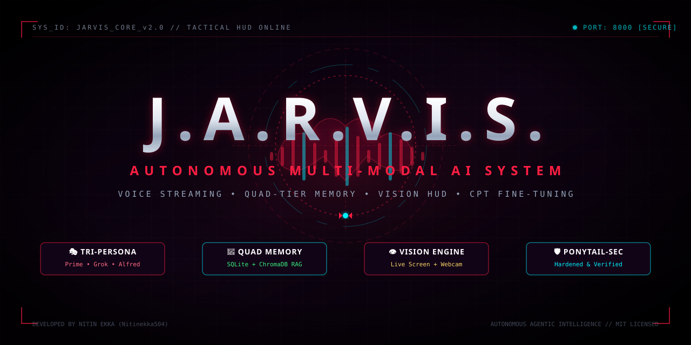

<p align="center">
  
</p>

# 🦇 J.A.R.V.I.S. • Autonomous Voice-Driven Multi-Modal AI System

[](LICENSE)
[](https://www.python.org/)
[](https://fastapi.tiangolo.com/)
[](https://websockets.readthedocs.io/)
[](#-security--ponytail-sec-hardening)

> *"It's not just a call... it's a warning."*  
> **J.A.R.V.I.S.** is a next-generation autonomous AI system combining real-time streaming voice input/output, multimodal vision (screen and webcam feeds), quad-tier persistent memory, continuous model weight fine-tuning, and a tactical cyberpunk visual HUD.

---

## ⚡ Core Architecture

```
                                  ┌──────────────────────────┐
                                  │   USER (Voice / HUD UI)   │
                                  └────────────┬─────────────┘
                                               │
                        ┌──────────────────────┴──────────────────────┐
                        ▼                                             ▼
         ┌──────────────────────────────┐              ┌──────────────────────────────┐
         │   Real-Time Voice Pipeline   │              │   Gotham Tactical Web HUD    │
         │  • STT Streaming / Barge-In  │              │  • Real-Time WebSockets      │
         │  • Speech Synthesis (en-GB)  │              │  • Hardware Telemetry Gauges │
         │  • UI Audio Cues & Chimes    │              │  • Multimodal Vision Overlay │
         └──────────────┬───────────────┘              └──────────────┬───────────────┘
                        │                                             │
                        └──────────────────────┬──────────────────────┘
                                               │
                                               ▼
                              ┌──────────────────────────────────┐
                              │    ReAct Reasoning Orchestrator   │
                              │  • Dynamic Persona Dispatch      │
                              │  • Reflexive Auto-Retry (3x)     │
                              │  • Zero-Downtime 429 Failover    │
                              └────────────────┬─────────────────┘
                                               │
         ┌─────────────────────────────────────┼─────────────────────────────────────┐
         ▼                                     ▼                                     ▼
┌──────────────────────────────┐ ┌──────────────────────────────┐ ┌──────────────────────────────┐
│     Quad-Tier Memory Store   │ │    Multimodal Vision Engine  │ │  Model Training & CPT Engine │
│ • Tier 1: Short-Term Buffer  │ │ • Primary Screen Capture     │ │ • 20% Rehearsal Protection   │
│ • Tier 2: Reflexive Store    │ │ • Live OpenCV Webcam Stream  │ │ • Target Projection Adapters │
│ • Tier 3: Acquired Knowledge │ │ • Instant Hardware Release   │ │ • GGUF Q4_K_M Quantization   │
│ • Tier 4: User Profile Store │ │ • Local & Cloud VLM Support  │ │ • Dynamic Modelfile Swapping │
└──────────────────────────────┘ └──────────────────────────────┘ └──────────────────────────────┘
```

---

## 🚀 Key Features

### 1. 🎭 Tri-Persona Adaptive Intelligence
* **JARVIS Protocol Prime (`jarvis`):** Composed, articulate British demeanor, unflappable delivery, and technical precision.
* **Grok Mode (`grok`):** Rebellious, witty, internet-native, and comfortably sarcastic with zero corporate filler.
* **Blended Edge (`blended` / `Alfred`):** Combines extreme systems engineering competence with sharp humor.

### 2. 🧠 Quad-Tier Memory Architecture
* **Tier 1 (Short-Term):** Real-time conversational context with dynamic sliding buffer.
* **Tier 2 (Reflexive Store):** Autonomous error analysis, self-correction tuples `(Context, Mistake, Correct Rule)`, and adaptive lessons learned.
* **Tier 3 (Acquired Knowledge):** Vector-embedded semantic search across research topics, technical articles, and acquired documents using SQLite and ChromaDB.
* **Tier 4 (User Profile):** Persistent tracking of user preferences, coding habits, daily schedules, and custom call-signs.

### 3. 👁️ Multimodal Vision Engine
* **Dual Capture Streams:** High-speed monitor capture via `mss` and live video feed via `OpenCV`.
* **Hardware Safeguards:** Automatic device handle closure (`auto_release=True`) on one-off queries to immediately turn off camera indicator lights.

### 4. 🎙️ Full-Duplex Audio & Streaming Voice
* **Barge-In Interruption:** Clears audio output buffers in `<50ms` when the user speaks while JARVIS is responding.
* **Streaming Synthesis:** Sentence-by-sentence streaming for instant vocal delivery without full-paragraph buffering delays.
* **Audio Cues:** Web Audio API procedural sound cues (wake-word confirmation, task completion triads, security alert sirens).

### 5. 🔬 Model Training Lab & CPT Engine
* **Dual-Storage Ingestion:** Simultaneous RAG indexing and raw token stream formatting (`/data/training/cpt_tokens.jsonl`).
* **Catastrophic Forgetting Defense:** Automatically mixes 20% general-domain and system-admin rehearsal samples into every training batch.
* **Ollama Integration:** Generates custom Modelfiles and hot-swaps active production reasoning models (`ollama create jarvis-v2`).

---

## 🛡️ Security & Ponytail-Sec Hardening

Project JARVIS has undergone an extensive security audit following the **Ponytail-Sec** methodology:

* **CSWSH Defense (SEC-01):** The WebSocket endpoint (`/ws`) enforces strict HTTP `Origin` header validation against `localhost` and `127.0.0.1`, rejecting malicious cross-origin requests with policy code `1008`.
* **CORS Policy:** Strict middleware limits HTTP API access to local origins.
* **Self-Modification Gate (SEC-02):** The `SelfModificationEngine` requires an explicit confirmation flag (`--confirm`) before any staging or test subprocess execution can run.
* **Indirect Prompt Injection Shield (SEC-03):** Scraped web text is sanitized to neutralize prompt injection phrases (`ignore all previous instructions`, system overrides) and isolated within `<web_source trust='untrusted'>` boundary delimiters.
* **Credential Protection (SEC-05):** Local API keys are masked in logs and telemetry, with zero hardcoded credentials committed to source control.
* **Subprocess PATH Verification (SEC-06):** External tools (e.g., MCP client) verify binary existence via `shutil.which()` before execution, falling back to safe offline mock modes.
* **Model Directive Sanitization (SEC-07):** Sanitizes inputs to prevent Modelfile escaping and instruction injection.

---

## 💻 Installation & Quick Start

### 1. Clone the Repository
```bash
git clone https://github.com/Nitinekka504/JARVIS.git
cd JARVIS
```

### 2. Set Up Virtual Environment
```bash
python -m venv .venv
# On Windows:
.venv\Scripts\activate
# On Linux/macOS:
source .venv/bin/activate
```

### 3. Install Dependencies
```bash
pip install -r requirements.txt
```

### 4. Configure Environment (Optional)
Copy or create your environment variables:
```bash
# Optional API Keys (JARVIS works offline with local Ollama fallback)
export GROQ_API_KEY="your_groq_key"
export OPENAI_API_KEY="your_openai_key"
export ANTHROPIC_API_KEY="your_anthropic_key"
```

### 5. Run JARVIS
```bash
python main.py
```

* **Tactical Visual HUD:** Open [http://127.0.0.1:8000](http://127.0.0.1:8000) in your browser.
* **Research Reports:** Available at [http://127.0.0.1:8000/reports](http://127.0.0.1:8000/reports).
* **Model Training Lab:** Available at [http://127.0.0.1:8000/training](http://127.0.0.1:8000/training).

---

## 🧪 Running the Test Suite

Execute the comprehensive automated test suite, including security and core architecture verification:

```bash
python -m unittest tests/run_tests.py
```


---

## 📜 License

This project is licensed under the MIT License - see the [LICENSE](LICENSE) file for details.

